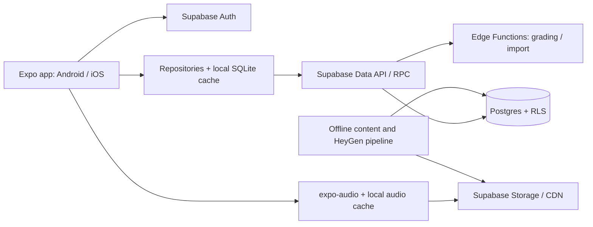

# Kế hoạch chuyển TOEIC Path sang React Native + Supabase

Cập nhật: 12/11/2026. Đây là kế hoạch triển khai; chưa tạo ứng dụng native, project Supabase hay thay đổi website production.

## 1. Mục tiêu và phạm vi MVP

- Một ứng dụng React Native dùng Expo, TypeScript và Expo Router cho Android/iOS; đánh giá bản web dùng chung sau khi luồng học trên mobile đạt yêu cầu.
- Giữ giao diện hiện tại, lộ trình 4/8/12 tuần, 246 câu hỏi, 10 đề, luyện từng phần, từ vựng, sổ lỗi sai và thống kê.
- Dùng Faye/Dmitri cho toàn bộ audio có sẵn. Phát file đã tạo, không sinh giọng khi người dùng nhấn Play.
- Supabase đảm nhiệm đăng nhập, Postgres, phân quyền dữ liệu, lưu audio và các thao tác server cần thiết.
- Đồng bộ tiến độ giữa thiết bị, tiếp tục bài đang làm và nhập dữ liệu từ bản web cũ.
- MVP chưa gồm thanh toán, marketplace nội dung, mạng xã hội, thi có giám sát hoặc dashboard quản trị lớn.

## 2. Các quyết định kiến trúc

### Frontend

**React Native + Expo + TypeScript + Expo Router.** Expo Router hỗ trợ định tuyến theo file cho native và web. Dùng `expo-audio` để phát, dừng, đổi tốc độ và quản lý vòng đời audio. Chọn phiên bản SDK và thư viện tương thích khi bắt đầu, khóa phiên bản bằng lockfile; không gán phiên bản mới nhất theo phỏng đoán. [Expo Router](https://docs.expo.dev/router/introduction/), [expo-audio](https://docs.expo.dev/versions/latest/sdk/audio/).

Tách logic học khỏi giao diện: chọn câu, tính thống kê, lộ trình, định dạng câu hỏi và kiểm tra dữ liệu thành module TypeScript thuần. UI hiện tại dùng DOM/HTML nên cần viết lại bằng View/Text/Pressable/FlatList, không chỉ đổi đuôi file. Chuyển hình minh họa SVG sang adapter hiển thị trên native và giữ dữ liệu gốc.

Giữ session làm bài trong reducer có trạng thái rõ ràng. Cache dữ liệu từ server và audio qua repository interface. Dùng SQLite trên thiết bị cho dữ liệu học/cache/outbox; auth storage theo hướng dẫn Supabase và kiểm tra cơ chế lưu/refresh session trên cả hai hệ điều hành. Không lưu token hay nội dung nhạy cảm vào log. [Supabase + Expo](https://supabase.com/docs/guides/getting-started/quickstarts/expo-react-native), [React Native Auth](https://supabase.com/docs/guides/auth/quickstarts/react-native).

### Backend

**Supabase Auth + Postgres + Storage**, bổ sung RPC/Edge Functions cho chấm bài, nhập dữ liệu và các thao tác cần quyền server. MVP chưa cần thêm Express/NestJS riêng vì Supabase đã cung cấp Data API và Auth. Đây là đề xuất phù hợp phạm vi hiện tại, không phải yêu cầu bắt buộc của nền tảng.

Client chỉ chứa URL và publishable key được phép dùng công khai; RLS bảo vệ dữ liệu theo tài khoản. `service_role` và khóa HeyGen chỉ thuộc môi trường server/CI. Edge Functions phải xác thực JWT và kiểm tra quyền sở hữu; không tin `user_id` do client gửi. [RLS](https://supabase.com/docs/guides/database/postgres/row-level-security), [Edge Functions](https://supabase.com/docs/guides/functions).



### Định hướng audio

- Audio được tạo một lần theo script và cặp voice đã chốt; câu hỏi dùng chung một đoạn nghe tham chiếu chung `audio_asset_id`.
- Dùng content hash để đặt tên/version file, ghi rõ provider, voice ID, script hash, file hash, thời lượng và tốc độ gốc.
- Giữ master PCM/WAV ngoài app bundle; cân nhắc MP3/AAC cho phân phối sau khi kiểm tra phát âm và chất lượng mã hóa.
- Nội dung hiện tại đã công khai: MVP có thể dùng bucket audio public cho việc đọc, chỉ server/admin được upload/xóa. Không dùng bucket public cho dữ liệu người học. Nếu có nội dung giới hạn quyền sau này, chuyển sang bucket private + signed URL có thời hạn. [Storage access control](https://supabase.com/docs/guides/storage/security/access-control).
- Cache audio theo hash, có giới hạn dung lượng và nút xóa cache. Hết hạn signed URL không đồng nghĩa file cache bị hỏng; xin URL mới trước khi tải lại.
- Chặn hai audio phát chồng; Stop/đổi câu/thoát màn hình phải giải phóng player. Chọn đáp án hoặc hiện giải thích không dựng lại player và không đưa màn hình về đầu trang.
- Luồng học không tự gọi HeyGen khi thiếu file. Ghi nhận file thiếu để admin xử lý, tránh phát sinh quota ở client.

## 3. Cấu trúc repo đề xuất

Không di chuyển toàn bộ repo ngay trong task lập kế hoạch. Tạo cấu trúc này ở nhánh migration khi bắt đầu thực hiện:

```text
apps/
  mobile/
    app/                  # Expo Router: auth, tabs, practice, results
    src/features/         # dashboard, study-plan, quiz, vocabulary, review
    src/components/       # question renderer, answer option, audio player
    src/repositories/     # Supabase/local adapters
    src/storage/          # SQLite cache, outbox, auth storage
packages/
  domain/                 # Types và logic học thuần TypeScript
  content/                # Export/validate 246 câu và 10 đề
supabase/
  migrations/             # Schema, indexes, RLS, RPC
  functions/              # submit-attempt, check-answer, import-progress
  tests/                  # Hai tài khoản, quyền dữ liệu, chấm bài
scripts/
  content/                # Validate/seed/version nội dung
  audio/                  # Manifest và upload audio; không chứa API key
legacy-web/               # Bản web hiện tại trong giai đoạn chuyển tiếp
docs/
```

## 4. Mô hình dữ liệu dự kiến

Giữ ID câu hỏi 1–246 và ID đề hiện có để nhập tiến độ. Dùng UUID cho bản ghi người học và attempt; version nội dung là trường riêng. Đây là thiết kế đề xuất, chưa phải migration SQL đã chạy.

| Bảng | Nội dung và khóa chính |
| --- | --- |
| profiles | user_id FK auth.users, tên hiển thị, ngôn ngữ, múi giờ |
| study_plans | UUID, user_id, target_score, weeks, minutes_per_day, start_date, revision |
| question_groups | ID/version, part, passage, illustration, audio_asset_id; gom câu dùng chung đoạn |
| questions | legacy_id + content_version, group_id, prompt, question_type, published |
| question_options | question/version + option_index, nội dung lựa chọn |
| private.answer_keys | Đáp án/explanation theo question/version; không expose trực tiếp qua Data API |
| practice_tests / test_questions | ID đề, mode mặc định; danh sách câu và vị trí ổn định |
| audio_assets | ID, storage_path, script_hash, file_hash, provider, voice metadata, duration, version |
| attempts | UUID, user_id, test/mode, status, started_at, expires_at, submitted_at, content_version, client_attempt_id |
| attempt_questions | Snapshot danh sách câu/thứ tự/version của một attempt |
| attempt_answers | attempt_id + question_id, selected_option, updated_at, revision |
| attempt_results | attempt_id, số đúng/tổng, accuracy, server_graded, graded_at |
| review_items | user_id + question/version, trạng thái cần ôn, last_reviewed_at |
| vocabulary / vocabulary_progress | 24 từ hiện có và tiến độ từng user; audio_asset_id cho ví dụ |
| study_events | user_id, activity, occurred_at, timezone; suy ra streak theo ngày địa phương |
| legacy_imports | user_id + payload_hash để ngăn import trùng; thống kê và lỗi nhập |

Quy ước: timestamps lưu UTC, giao diện dùng múi giờ tài khoản. Study-plan start_date là ngày địa phương. Thêm index `(user_id, created_at)`/`(user_id, status)` theo truy vấn thực tế; unique constraint cho client_attempt_id theo user và khóa của progress/review.

### Phân quyền và chấm bài

- Bật RLS cho mọi bảng exposed. Profile, kế hoạch, attempt, câu trả lời, thống kê và tiến độ từ vựng chỉ thuộc tài khoản hiện tại.
- Content đã published có thể đọc theo chính sách của sản phẩm; chỉ admin/server sửa nội dung.
- Quyền đọc answer dùng EXISTS qua attempt thuộc user; dữ liệu con không chỉ kiểm tra một user_id do client tự đặt.
- `start-attempt`: server chốt danh sách câu/version và `expires_at` cho timed test.
- `save-answer`: kiểm tra attempt đang mở, câu thuộc attempt, option hợp lệ và revision hiện tại.
- `check-answer`: chỉ trả feedback ngay trong learning mode; không tiết lộ đáp án của timed attempt còn mở.
- `submit-attempt`: idempotent, chấm bằng answer_keys phía server, chốt kết quả và cập nhật review/statistics trong một transaction.
- Không cho client tự ghi điểm, submitted_at hay server_graded. Function dùng SECURITY DEFINER phải khóa search_path và tự kiểm tra auth.uid(); nếu dùng service role thì phải kiểm tra quyền rõ ràng vì service role có thể bypass RLS.
- Đây vẫn là công cụ luyện tập, không phải hệ thống thi chính thức có chống gian lận/giám sát.

## 5. Luồng ứng dụng

1. **Onboarding/Auth:** đăng ký/đăng nhập email, khôi phục mật khẩu, chọn mục tiêu và lịch học; kiểm tra deep link trên thiết bị thật. OAuth là phần bổ sung sau MVP nếu cần.
2. **Dashboard:** đọc plan/progress từ cache, đồng bộ nền khi có mạng, hiển thị rõ trạng thái offline.
3. **Practice:** tải group + questions + audio metadata, cache audio, chọn đáp án tại chỗ, hiện giải thích bên dưới nút bấm.
4. **Timed tests:** bắt đầu online, lấy thời hạn server, phục hồi attempt đang mở. Mất mạng không đặt lại đồng hồ hoặc kéo dài thời hạn; việc nhận câu trả lời muộn phải được server từ chối theo quy tắc đã thống nhất.
5. **Results/Review:** lấy kết quả server; làm lại lỗi sai, ghi nhận lịch sử học, thống kê và streak theo múi giờ.
6. **Vocabulary:** giữ thẻ Anh–Việt, âm thanh Faye/Dmitri và tiến độ từng tài khoản.
7. **Settings:** mục tiêu, thời gian học, tốc độ audio, xóa cache, export/import và đăng xuất.

## 6. Offline và chuyển dữ liệu từ web

- Learning mode có thể làm offline với content/audio đã tải; lưu answer/event vào outbox có ID ổn định. Mặc định feedback cần mạng; nếu muốn chấm ngay offline, cấp riêng bộ learning có đáp án đã tải và hiển thị rõ kết quả tạm tính, không dùng bộ đó để bảo vệ đáp án timed test. Timed mode cần server xác nhận lúc bắt đầu và chốt bài theo thời hạn server.
- Khi có mạng, retry đồng bộ dữ liệu với backoff và idempotency key. Không retry tạo audio HeyGen tự động.
- Attempt đã submitted là bất biến. Hai thiết bị sửa attempt đang mở dùng optimistic revision; server từ chối ghi đè bản mới bằng bản cũ, UI cho tải lại trạng thái chuẩn.
- Người dùng export JSON v1 từ web, chọn file trong app và xem bản tóm tắt trước khi import. Kiểm tra schema, kích thước, ID câu hỏi và ngày giờ.
- Không tin điểm gửi trong file: tính lại dựa trên đáp án/version nếu có đủ thông tin. Giữ kết quả lịch sử với `source=legacy_import` và `server_graded=false` khi không thể kiểm chứng.
- Dedupe bằng payload hash và ID ổn định; nhập lại cùng file không nhân đôi lịch sử. Import không được tự động xóa tiến độ hiện có; có báo cáo số bản ghi mới/trùng/lỗi.
- Chỉ ghi vào tài khoản đang đăng nhập, không nhận user_id từ file. Giữ bản backup gốc để đối chiếu và rollback import.

## 7. Lộ trình thực hiện và điều kiện nghiệm thu

Ước lượng MVP khoảng **2–4 tuần làm việc của một lập trình viên**, cần điều chỉnh sau PoC; không bao gồm thời gian xét duyệt App Store/Play Store. Chưa chốt ngày triển khai hay cam kết chi phí cloud.

| Giai đoạn | Công việc | Điều kiện hoàn thành |
| --- | --- | --- |
| 0 · 1–2 ngày | Export content có schema, kiểm tra ID/hash/audio, PoC Expo + audio + Auth storage | 246 câu, 10 đề, 102 bản thu hiện có được kiểm kê; phát trên Android/iOS thật |
| 1 · 2–3 ngày | Expo/TypeScript/router, design tokens, screen shell, repositories | Điều hướng đủ màn hình; logic quiz không phụ thuộc DOM/window |
| 2 · 2–3 ngày | Supabase migrations, RLS, seed, Auth, Storage | Hai user không đọc/sửa tiến độ của nhau; app không chứa service key |
| 3 · 3–4 ngày | Luyện từng phần, timed test, server grading, audio/cache | Điểm đúng; Stop/rate đúng; đổi đáp án không nhảy vị trí; timeout không bị lách bằng đổi giờ máy |
| 4 · 2–3 ngày | Review/vocab/stats/plan, outbox, import JSON | Resume và đồng bộ hai thiết bị; import lặp không tạo bản ghi trùng |
| 5 · 1–2 ngày | E2E, thiết bị thật, performance, release build, tài liệu | Không mất tiến độ khi app background/đóng; checklist phát hành và rollback có kết quả |

Các nhánh triển khai dự kiến: `codex/mobile-foundation`, `codex/supabase-auth-content`, `codex/native-quiz-audio`, `codex/progress-sync-import`, `codex/mobile-release`. Mỗi thay đổi là PR nhỏ, có test và mô tả hành vi; giữ `fix-voice` tập trung vào audio và tài liệu kế hoạch hiện tại.

## 8. Kiểm thử và vận hành

- Unit: chọn câu, mapping ID/version, thống kê, server scoring, import/dedupe và state machine attempt.
- Database: RLS với user A/B/anonymous, invalid option, câu không thuộc attempt, submit lặp và submit quá hạn.
- Audio: URL hợp lệ, file/duration/hash, nghe số tiền/giờ/phủ định, preload/cache, Stop, tốc độ/pitch, headset/interruption và vòng đời foreground/background.
- E2E: đăng nhập → plan → bài nghe → kết quả → notebook → đổi thiết bị → import; kiểm tra trên Android/iOS thật và web nếu chọn phát hành web.
- Theo dõi lỗi không chứa token, timeout API, outbox chưa đồng bộ, thời gian tải audio và Storage egress. Đặt cảnh báo ngân sách theo hạn mức project thực tế.
- Tách môi trường dev/staging/prod, migrations review trước khi áp dụng; backup dữ liệu trước import lớn và có phương án quay lại ứng dụng cũ.
- CI: typecheck, unit/database tests, kiểm tra manifest audio và build; secret chỉ ở CI/server. EAS build/distribution được cấu hình khi bước triển khai được duyệt.

## 9. Trình tự bắt đầu sau khi duyệt kế hoạch

- [ ] Chốt Android/iOS trước hay có cả web trong MVP, hình thức đăng nhập và chính sách offline timed tests.
- [ ] Xác nhận tài khoản Supabase, region, staging/prod và ngân sách; không tạo project cloud trong task lập kế hoạch này.
- [ ] Chọn SDK Expo tương thích và hoàn thành PoC audio/Auth trên thiết bị thật.
- [ ] Viết migrations và RLS tests trước khi nối UI vào dữ liệu production.
- [ ] Chuyển từng luồng và đối chiếu với web hiện tại; chỉ chuyển người dùng khi tiêu chí nghiệm thu đạt.

## Tài liệu chính thức đã đối chiếu

- https://docs.expo.dev/router/introduction/
- https://docs.expo.dev/versions/latest/sdk/audio/
- https://supabase.com/docs/guides/getting-started/quickstarts/expo-react-native
- https://supabase.com/docs/guides/auth/quickstarts/react-native
- https://supabase.com/docs/guides/database/postgres/row-level-security
- https://supabase.com/docs/guides/storage/security/access-control
- https://supabase.com/docs/guides/functions
